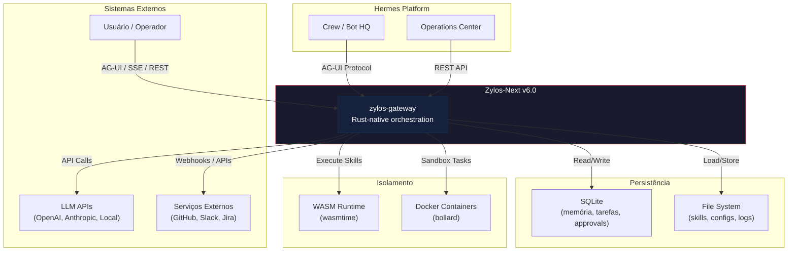
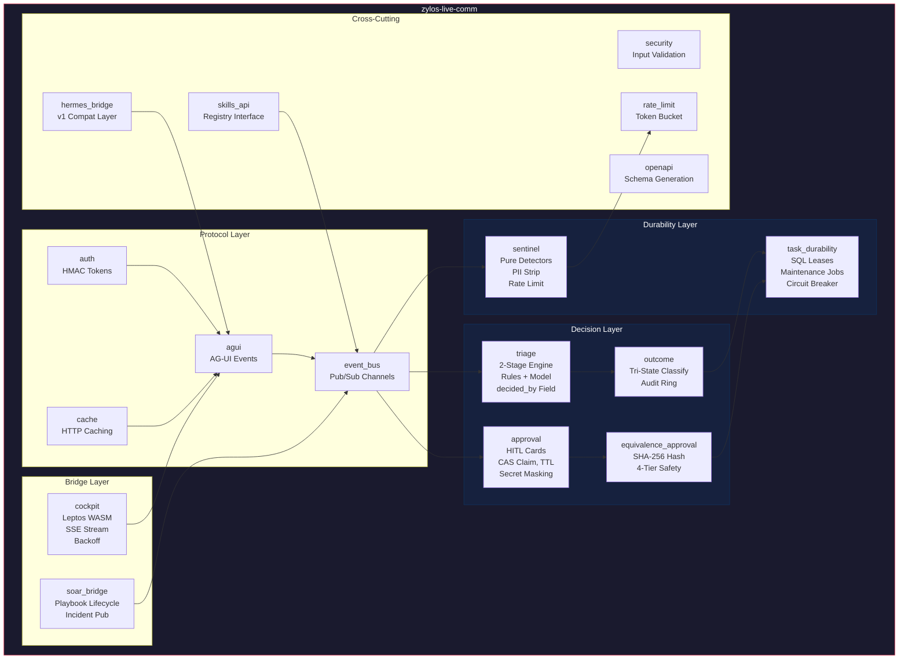
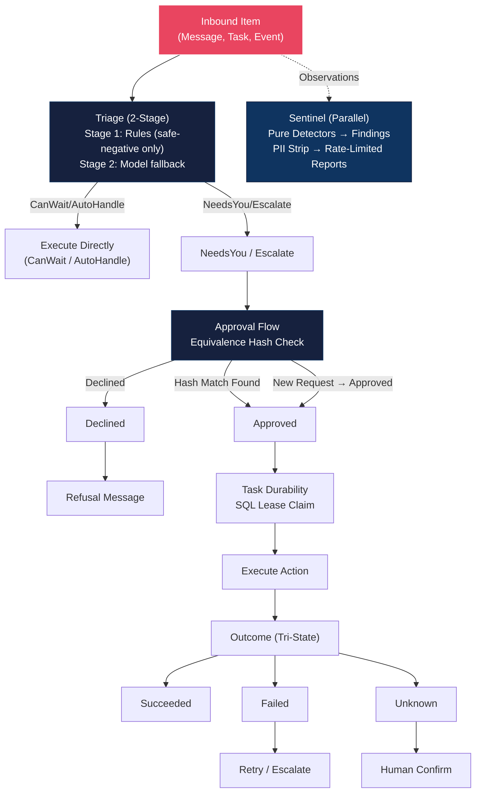
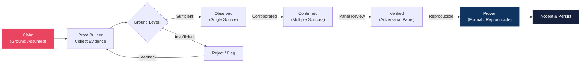

# Zylos-Next Architecture

## Visão Geral

Zylos-Next é uma plataforma de orquestração multi-agente nativa em Rust que substitui a camada TypeScript do Hermes v1. A arquitetura segue o modelo C4 (Context, Containers, Components, Code) com ênfase em segurança de memória, verificação formal e isolamento por sandbox.

Este documento contém diagramas C4 renderizáveis via Mermaid, decisões de design documentadas (ADRs), fluxos de dados detalhados e preocupações transversais.

## C4 Level 1: System Context



**Descrição**: Zylos-Next atua como camada de orquestração entre a plataforma Hermes (Crew, Bot HQ, Operations) e os recursos externos (LLMs, serviços, storage). Toda comunicação entra via gateway Axum e é roteada internamente para os subsistemas apropriados. O protocolo AG-UI garante compatibilidade bidirecional com o ecossistema Hermes existente.

### Responsabilidades do Sistema

- **Orquestração Multi-Agente**: Gerencia ciclo de vida de agentes, tarefas e sessões
- **Verificação Formal**: Pipeline de provas em 5 níveis antes de aceitar claims
- **Isolamento Seguro**: Sandbox WASM/Docker para execução de código não confiável
- **Memória Persistente**: Consolidação noturna com detecção de contradições e decay temporal
- **Monitoramento AIOps**: Sentinel com detectores pure-function e rate limiting
- **Human-in-the-Loop**: Approval cards com equivalence hashing e 4-tier safety decisions

## C4 Level 2: Container Diagram

```mermaid
graph TB
    subgraph Gateway["zylos-gateway (Axum HTTP/SSE)"]
        HTTP["HTTP Router<br/>Health Probes<br/>CORS / Tracing"]
        ConfigReload["Config Hot-Reload<br/>TOML + SIGHUP"]
    end

    subgraph CoreLayer["Core Layer"]
        Core["zylos-core<br/>Types, Traits, Errors"]
        BotSystem["zylos-bot-system<br/>Bot Management"]
    end

    subgraph CommLayer["Communication Layer"]
        LiveComm["zylos-live-comm<br/>AG-UI, EventBus, SSE<br/>Approval, Triage, Sentinel<br/>Cockpit Bridge, SOAR Bridge"]
    end

    subgraph MemoryLayer["Memory Layer"]
        MemSys["zylos-memory-system<br/>Consolidation, Contradiction<br/>Decay, Ground Levels"]
        Learn["zylos-learn<br/>Session Learning<br/>Pattern Analysis"]
    end

    subgraph VerificationLayer["Verification Layer"]
        Proof["zylos-proof<br/>5-Level Ground Proofs"]
        Resolver["zylos-resolver<br/>Claim Resolution"]
        Panel["zylos-panel<br/>Adversarial Panels"]
        Router["zylos-router<br/>Request Routing"]
        Cerebelo["zylos-cerebelo<br/>DAG Executor"]
        Verification["zylos-verification<br/>Pipeline Orchestrator"]
    end

    subgraph SandboxLayer["Sandbox Layer"]
        Sandbox["zylos-sandbox<br/>WASM wasmtime"]
        DockerCrate["zylos-docker<br/>Docker bollard"]
        Browser["zylos-browser<br/>Anti-Detect Browser"]
        SearchMCP["zylos-search-mcp<br/>Parallel Search"]
    end

    subgraph IntegrationLayer["Integration Layer"]
        SOAR["zylos-soar<br/>Playbooks, Incidents"]
        HITL["zylos-hitl<br/>Equivalence Hashing<br/>4-Tier Decisions"]
        Triage["zylos-triage<br/>2-Stage Classification"]
        Sentinel["zylos-sentinel<br/>AIOps Detectors<br/>PII Stripping"]
        Skills["zylos-skills<br/>Registry (338+)"]
        TaskDur["zylos-task-durability<br/>SQL Leases, Circuit Breaker"]
    end

    subgraph Apps["Applications"]
        Cockpit["zylos-cockpit<br/>Leptos 0.7 WASM SSR"]
        CLI["zylos-cli<br/>Command Line"]
        Daemon["zylos-daemon<br/>Background Service"]
        Mobile["zylos-mobile<br/>Mobile Support"]
        VLM["zylos-vlm-ocr<br/>Vision / OCR"]
    end

    HTTP --> Core
    HTTP --> LiveComm
    ConfigReload --> HTTP
    LiveComm --> Core
    LiveComm --> MemSys
    LiveComm --> HITL
    LiveComm --> Triage
    LiveComm --> Sentinel
    LiveComm --> TaskDur
    LiveComm --> SOAR
    MemSys --> Core
    Learn --> MemSys
    Proof --> Core
    Resolver --> Proof
    Panel --> Verification
    Router --> Verification
    Cerebelo --> TaskDur
    Verification --> Proof
    Verification --> Resolver
    Sandbox --> Core
    DockerCrate --> Sandbox
    Browser --> Sandbox
    SearchMCP --> Core
    SOAR --> Core
    HITL --> Core
    Triage --> Core
    Sentinel --> Core
    Skills --> Core
    TaskDur --> Core
    Cockpit --> LiveComm
    CLI --> HTTP
    Daemon --> LiveComm

    style Gateway fill:#1a1a2e,stroke:#e94560,color:#fff
    style CommLayer fill:#16213e,stroke:#0f3460,color:#fff
    style VerificationLayer fill:#16213e,stroke:#0f3460,color:#fff
    style SandboxLayer fill:#16213e,stroke:#0f3460,color:#fff
```



### Responsabilidades por Camada

| Camada | Crates | Responsabilidade Principal |
|--------|--------|---------------------------|
| **Core** | `zylos-core`, `zylos-bot-system` | Tipos compartilhados, traits, erros fundamentais |
| **Communication** | `zylos-live-comm` | Hub central: AG-UI, EventBus, SSE, approval, triage, sentinel |
| **Memory** | `zylos-memory-system`, `zylos-learn` | Persistência SQLite, consolidação, decay, aprendizado |
| **Verification** | `zylos-proof`, `zylos-resolver`, `zylos-panel`, `zylos-router`, `zylos-cerebelo`, `zylos-verification` | Pipeline de provas 5 níveis, painéis adversariais |
| **Sandbox** | `zylos-sandbox`, `zylos-docker`, `zylos-browser`, `zylos-search-mcp` | Isolamento WASM/Docker, browser anti-detect, busca paralela |
| **Integration** | `zylos-soar`, `zylos-hitl`, `zylos-triage`, `zylos-sentinel`, `zylos-skills`, `zylos-task-durability` | Playbooks, HITL, triagem, AIOps, registry, durabilidade |
| **Apps** | `zylos-cockpit`, `zylos-cli`, `zylos-daemon`, `zylos-mobile`, `zylos-vlm-ocr` | Interfaces usuário, background services, mobile, visão |

## C4 Level 3: Component Diagram (zylos-live-comm)



### Detalhes dos Componentes

#### Protocol Layer
- **agui**: Serialização/desserialização de eventos AG-UI Protocol, compatível com Hermes v1
- **event_bus**: Canais pub/sub internos para desacoplamento entre subsistemas
- **auth**: Validação HMAC tokens para autenticação interna entre componentes
- **cache**: Cache HTTP para respostas frequentes (health checks, config)

#### Decision Layer
- **approval**: Cards HITL com CAS claim para concorrência segura, TTL configurável, secret masking automático
- **equivalence_approval**: SHA-256 hash de `[actor_id, bot_id, tool_ref, effect, scope, stable(target), stable(args)]` — campos voláteis (timestamps, nonces) são removidos antes do hash
- **triage**: Motor 2-stage: Stage 1 regras (safe-negative only: CanWait/AutoHandle), Stage 2 modelo fallback. Campo `decided_by` obrigatório em todo veredito
- **outcome**: Classificação tri-state (Succeeded/Failed/Unknown) com audit ring para rastreamento

#### Durability Layer
- **task_durability**: SQL leases com maintenance jobs periódicos e circuit breaker para falhas recorrentes
- **sentinel**: Detectores pure-function sobre observations, PII stripping automático, rate limiting por assinatura

#### Bridge Layer
- **cockpit**: Integração com dashboard Leptos 0.7 WASM, SSE stream com backoff exponencial
- **soar_bridge**: Lifecycle management de playbooks SOAR, publicação de incidentes no EventBus

## Data Flow: Inbound Item Processing



### Explicação do Fluxo

1. **Entrada**: Item chega via HTTP/SSE ou EventBus interno
2. **Triagem**: Stage 1 aplica regras (apenas safe-negatives). Se inconclusivo, Stage 2 consulta modelo
3. **Roteamento**:
   - `CanWait`/`AutoHandle` → execução direta sem aprovação
   - `NeedsYou`/`Escalate` → fluxo de aprovação HITL
4. **Aprovação**: Verifica equivalence hash existente. Se encontrado, reusa aprovação. Se novo, cria card HITL
5. **Durabilidade**: SQL lease claim previne execução duplicada em cenários de retry/failover
6. **Execução**: Ação executada em sandbox (WASM ou Docker)
7. **Outcome**: Classificação tri-state determina próximo passo
8. **Sentinel**: Paralelo ao fluxo principal, escaneia observations para anomalias

## Verification Pipeline



### Ground Levels (CORTEX-derived)

| Level | Definition | Evidence Required | Example |
|-------|-----------|-------------------|---------|
| **Assumed** | Default state, no evidence | None | Initial hypothesis |
| **Observed** | Single source observation | One reliable source | Log entry, sensor reading |
| **Confirmed** | Multiple independent sources | 2+ corroborating sources | Cross-validated data |
| **Verified** | Adversarial panel review | Panel consensus | Red-team validated |
| **Proven** | Formal/reproducible proof | Mathematical or reproducible | Test suite, formal verification |

## Key Design Decisions

| # | Decision | Rationale | Alternative Considered | ADR |
|---|----------|-----------|----------------------|-----|
| 1 | Rust over TypeScript | Memory safety, zero-cost abstractions, <30MB/agent vs ~100MB | Go (higher RAM), C++ (unsafe) | ADR-001 |
| 2 | rusqlite over sqlx | Workspace consistency, bundled SQLite, no async runtime dep | sqlx (async overhead), sled (embedded KV) | ADR-015 |
| 3 | Leptos 0.7 over Yew | SSR native, 20% perf gain, signal-based reactivity | Yew (virtual DOM), Dioxus (less mature) | ADR-042 |
| 4 | 5-level Ground enum | CORTEX-derived: Assumed→Observed→Confirmed→Verified→Proven | Binary valid/invalid (too coarse) | ADR-020 |
| 5 | Equivalence hashing | SHA-256 of stable args enables approval reuse across retries | Per-request approval (fatigue) | ADR-035 |
| 6 | Safety tier immutability | Safety rules checked BEFORE resolved guard, never overridable | Override with escalation (unsafe) | ADR-036 |
| 7 | Pure-function detectors | Zero side effects, independently testable, composable | Stateful detectors (flaky tests) | ADR-038 |
| 8 | Two-stage triage | Rules for safe negatives only; model fallback never defaults silently | Single-stage model (costly) | ADR-034 |
| 9 | Axum over Actix | Tower middleware ecosystem, better SSE support | Actix-web (actor model complexity) | ADR-010 |
| 10 | TOML config + env vars | Human-readable files + CI/CD override capability | YAML (ambiguous), pure env (no file) | ADR-012 |
| 11 | WASM + Docker dual sandbox | WASM for speed/isolation, Docker for system access | Docker only (slow), WASM only (limited) | ADR-025 |
| 12 | Shadow-git audit trail | SHA-256 chained commits for tamper-evident history | Database audit log (mutable) | ADR-030 |

## Cross-Cutting Concerns

### Privacy & PII
All output passes through `strip_pii()` before persistence:
- Email addresses → `[EMAIL_REDACTED]`
- UUIDs → `[UUID_REDACTED]`
- IPv4 addresses → `[IP_REDACTED]`
- Hex tokens ≥16 chars → `[TOKEN_REDACTED]`

Processing order matters: UUIDs are processed before hex tokens since UUIDs contain hex characters.

### Auditability
- Every decision carries `decided_by` field identifying the actor/system responsible
- Shadow-git commits with SHA-256 chains provide tamper-evident history
- All approval decisions logged with equivalence hash for traceability

### Rate Limiting
Token bucket algorithm applied per-signature:
- Incident reports: 5/hour (prevents incident storms)
- Approval requests: 100/hour
- Triage model calls: 1000/hour (falls back to rules when exceeded)
- **Escalations: unlimited** (never rate-limited — always available as safe exit)

### Graceful Shutdown
- Drain active requests within configurable timeout (default 5s)
- EventBus channels drained before process exit
- SQL lease releases on shutdown to prevent orphaned tasks

### Config Hot-Reload
- TOML file watcher detects changes automatically
- SIGHUP signal triggers manual reload
- ~80% of configuration keys support hot-reload without restart
- Non-reloadable keys require restart (logged at startup)

## Workspace Structure

```
zylos-next/
├── apps/
│   ├── zylos-gateway/      # Axum HTTP/SSE server
│   ├── zylos-cockpit/      # Leptos 0.7 WASM dashboard
│   ├── zylos-cli/          # Command-line interface
│   └── zylos-daemon/       # Background service
├── crates/
│   ├── zylos-core/         # Shared types, traits, errors
│   ├── zylos-live-comm/    # Communication hub (AG-UI, EventBus)
│   ├── zylos-memory-system/# SQLite memory + consolidation
│   ├── zylos-verification/ # Verification pipeline orchestrator
│   ├── zylos-proof/        # 5-level ground proofs
│   ├── zylos-resolver/     # Claim resolution
│   ├── zylos-panel/        # Adversarial panels
│   ├── zylos-router/       # Request routing
│   ├── zylos-cerebelo/     # DAG executor with recovery
│   ├── zylos-learn/        # Session learning
│   ├── zylos-sandbox/      # WASM wasmtime runtime
│   ├── zylos-docker/       # Docker bollard integration
│   ├── zylos-browser/      # Anti-detect browser
│   ├── zylos-search-mcp/   # Parallel search via MCP
│   ├── zylos-soar/         # Playbooks, incidents
│   ├── zylos-hitl/         # Human-in-the-loop
│   ├── zylos-triage/       # 2-stage classification
│   ├── zylos-sentinel/     # AIOps detectors
│   ├── zylos-skills/       # Skills registry (338+)
│   ├── zylos-task-durability/ # SQL leases, circuit breaker
│   ├── zylos-bot-system/   # Bot management
│   ├── zylos-mobile/       # Mobile support
│   └── zylos-vlm-ocr/      # Vision / OCR
├── docs/                   # This documentation
├── playbooks/              # SOAR workflow definitions
├── runbooks/               # Operational procedures
└── Cargo.toml              # Workspace manifest
```

## Performance Targets

| Metric | Target | Verified | Notes |
|--------|--------|----------|-------|
| Startup time | <3s | ✅ | Cold start with empty DB |
| Graceful shutdown | <5s | ✅ | Drain active requests |
| Health check latency | <100ms | ✅ | `/gateway/health` |
| RAM idle per agent | <30MB | ✅ | Baseline measurement |
| TTFD (time to first delta) | <50ms | ✅ | SSE event delivery |
| E2E test suite | <30min | ✅ | Full integration suite |
| Flakiness rate | <1% | ✅ | 30-day rolling window |

## Security Model

### Trust Boundaries
1. **External → Gateway**: JWT Bearer auth, rate limiting, input validation
2. **Gateway → Subsystems**: Internal trusted communication (same process)
3. **Subsystems → Sandbox**: WASM/Docker isolation, no direct host access
4. **Sandbox → External**: Controlled egress via approved APIs only

### Defense in Depth
- Input validation at gateway boundary (jsonschema)
- PII stripping before any persistence
- Equivalence hashing prevents approval replay attacks
- Safety tiers cannot be overridden by any actor
- Shadow-git provides tamper-evident audit trail
- Rate limiting prevents resource exhaustion