# Guia do Usuário — Cockpit Zylos

**Data:** 2026-11-17
**Versão:** 1.1.0 (Fase 11.6.1 — screenshots reais)
**Público-alvo:** Operadores, desenvolvedores e administradores do sistema Zylos-Next

---

## Índice

1. [Introdução](#1-introdução)
2. [Acesso e Autenticação](#2-acesso-e-autenticação)
3. [Visão Geral da Interface](#3-visão-geral-da-interface)
4. [Guia de Tabs (31 seções)](#4-guia-de-tabs)
5. [Workflows Comuns](#5-workflows-comuns)
6. [Keyboard Shortcuts](#6-keyboard-shortcuts)
7. [Troubleshooting](#7-troubleshooting)
8. [Referências](#8-referências)
9. [Sobre os Screenshots](#9-sobre-os-screenshots)

---

## 1. Introdução

O **Cockpit Zylos** é a interface web de operação e monitoramento do sistema multi-agente Zylos-Next. Construído com Leptos 0.7 (Rust/WASM), oferece 31 seções organizadas em categorias funcionais para gerenciar agentes, tarefas, memória, segurança, governança e integrações.

### Requisitos
- Browser moderno com suporte WASM (Chrome 120+, Firefox 121+, Safari 17+)
- Conexão com o gateway Zylos (`http://localhost:3000` por padrão)
- Autenticação JWT (obtida via `/api/v1/auth/login`)

### Primeira tela: estado offline (gateway ausente)

O cockpit é um bundle WASM estático; ao abrir, chama `GET http://localhost:3000/api/v1/health` (função `fetch_health()` em `apps/zylos-cockpit/src/app.rs`). Se o gateway não responde, a área principal mostra **"Connection lost: … Failed to fetch"** e o botão **"Tentar novamente"** — as tabs ficam visíveis mas o conteúdo não é renderizado. É exatamente o que acontece no preview público, porque o gateway ainda não está deployado:

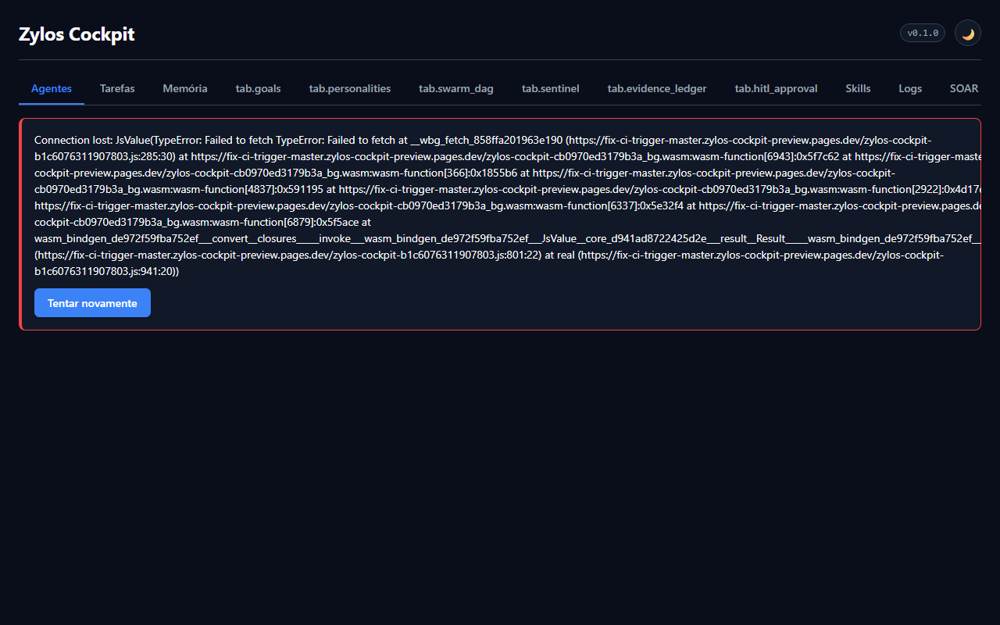

Para operar de verdade, suba o gateway local (`cargo run -p zylos-gateway`, escuta em `127.0.0.1:3000` por padrão; override com `ZYLOS_LISTEN`) e abra o cockpit a partir de uma origem local (`trunk serve` em `apps/zylos-cockpit`, ou `scripts/zylos-start.sh`). O gateway aplica `local_guard::so_desta_maquina` e só aceita `Origin` desta máquina (`apps/zylos-gateway/src/local_guard.rs`).

---

## 2. Acesso e Autenticação

> **Estado atual (verificado no código em 2026-11-17):** o componente `auth_login.rs` existe em `apps/zylos-cockpit/src/components/`, mas **não está montado** em `App` (`app.rs`) — o preview abre direto no dashboard, sem tela de login. Os endpoints `/api/v1/auth/login` e `/api/v1/auth/register` existem no gateway. O fluxo abaixo descreve o comportamento planejado.

### 2.1 Login
1. Acesse a URL do cockpit
2. Na tela de login, insira credenciais ou registre nova conta
3. O token JWT é armazenado automaticamente em `localStorage`
4. Presence indicators mostram quem está editando no momento

### 2.2 Registro
1. Clique em "Register" na tela de login
2. Preencha username, password e (opcional) display name
3. Receba token JWT com role `user` (padrão)
4. Admin pode elevar roles via endpoint `/api/v1/auth/roles`

### 2.3 Logout e Revogação
- Botão de logout no header limpa token local
- Admin pode revogar tokens via `pop-token-revoke.md`

---

## 3. Visão Geral da Interface

### Layout
```
┌─────────────────────────────────────────────────────┐
│ Header: Logo + User Info + Theme Toggle + Logout    │
├─────────────────────────────────────────────────────┤
│ Nav Bar: 31 tabs agrupadas por categoria            │
├─────────────────────────────────────────────────────┤
│ Content Area: Componente da tab ativa               │
│ (muda dinamicamente conforme seleção)               │
└─────────────────────────────────────────────────────┘
```

### Temas
- **Dark mode** (padrão): `--color-bg: #0f1117`, texto claro
- **Light mode**: `--color-bg: #f8fafc`, texto escuro
- Toggle persistente em `localStorage`

### Notificações
- **Toast system** (4 tipos): success, error, warning, info
- Aparecem no canto inferior direito
- Auto-dismiss após 5s (exceto errors)

---

## 4. Guia de Tabs

### 4.1 Agents (Roster de Agentes)
**Ícone:** 🤖  
**Descrição:** Lista todos os agentes ativos com status, uptime, métricas de uso.

**Componentes:**
- `LazyRoster`: Carregamento paginado com scroll virtual
- `AgentCard`: Detalhes por agente (nome, role, task count, last active)

**Ações:**
- Clique no agente → abre detalhes completos
- Filtro por status: running/idle/blocked/archived
- Busca por nome/role

**Screenshot real (preview, 2026-11-17):**

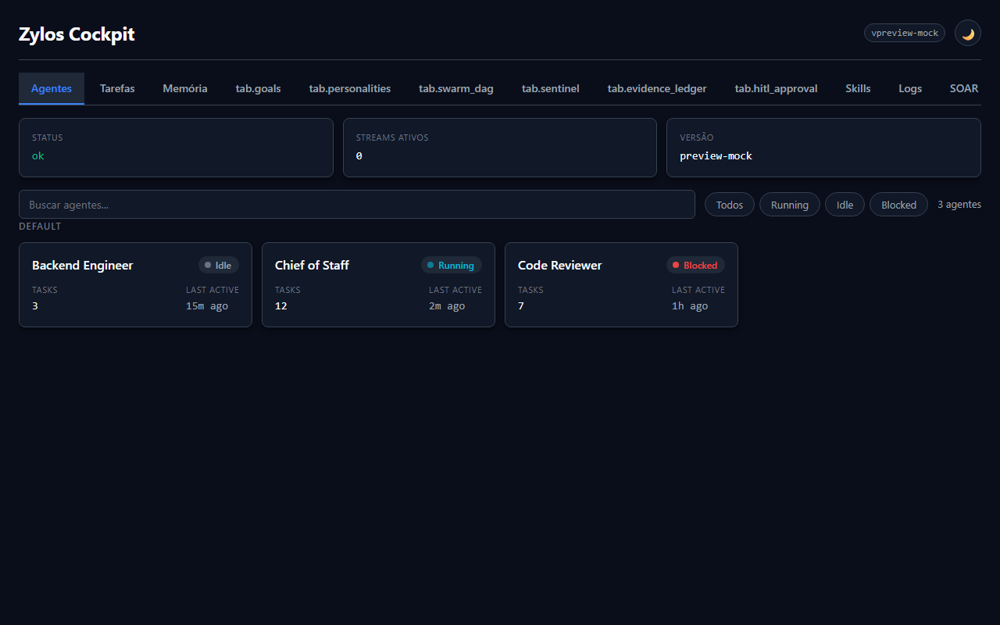

*Estado capturado:* cards de amostra (`sample_agents()` em `app.rs`): Backend Engineer/Idle, Chief of Staff/Running, Code Reviewer/Blocked.

---

### 4.2 Tasks (DAG de Tarefas)
**Ícone:** 📋  
**Descrição:** Visualização DAG (Directed Acyclic Graph) de tarefas com dependências.

**Componentes:**
- `TasksDag`: Grafo SVG com nós (tarefas) e arestas (dependências)
- Drag-and-drop para reordenar
- Zoom/pan via wheel

**Estados:**
- `pending`: cinza
- `ready`: azul (dependências resolvidas)
- `running`: amarelo pulsante
- `completed`: verde
- `failed`: vermelho

**Ações:**
- Clique em nó → detalhes da tarefa
- Botão "Retry" em tarefas failed
- "Force Complete" (admin only)

**Screenshot real (preview, 2026-11-17):**

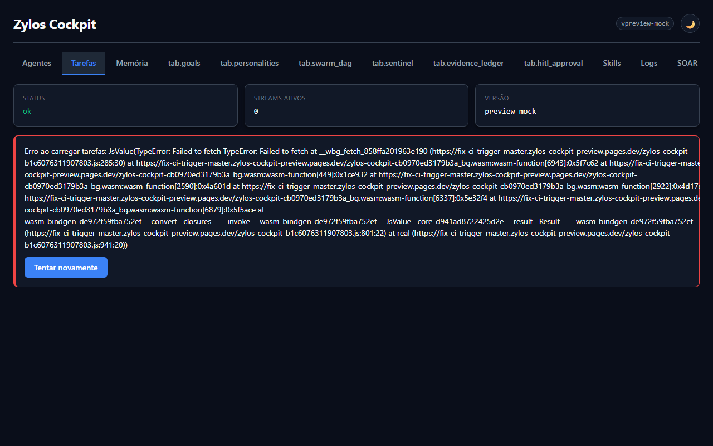

*Estado capturado:* "Erro ao carregar tarefas: … Failed to fetch" — erro de fetch (gateway ausente).

---

### 4.3 Memory (Timeline)
**Ícone:** 🧠  
**Descrição:** Timeline cronológica de memórias (short-term, long-term, episodic).

**Componentes:**
- `MemoryTimeline`: Scroll vertical com marcadores de tempo
- Filtros: tipo (fact/skill/episode), data, relevância

**Interações:**
- Hover → preview completo
- Clique → expande detalhes + contexto
- Botão "Consolidate" → merge memórias similares (background job)

**Screenshot real (preview, 2026-11-17):**

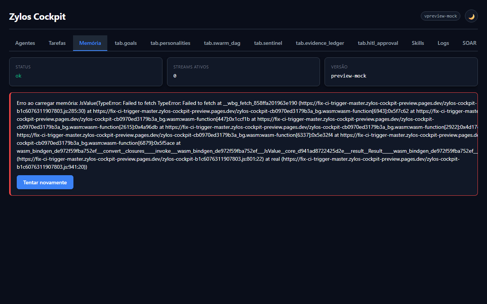

*Estado capturado:* "Erro ao carregar memória" — erro de fetch (gateway ausente).

---

### 4.4 Goals (Painel de Metas)
**Ícone:** 🎯  
**Descrição:** Métricas de progresso em goals hierárquicos.

**Componentes:**
- `GoalsPanel`: Cards com barras de progresso, milestones
- Gráficos de tendência (últimos 30 dias)

**Ações:**
- Criar novo goal (modal)
- Editar target/criteria
- Marcar milestone como atingido

**Screenshot real (preview, 2026-11-17):**

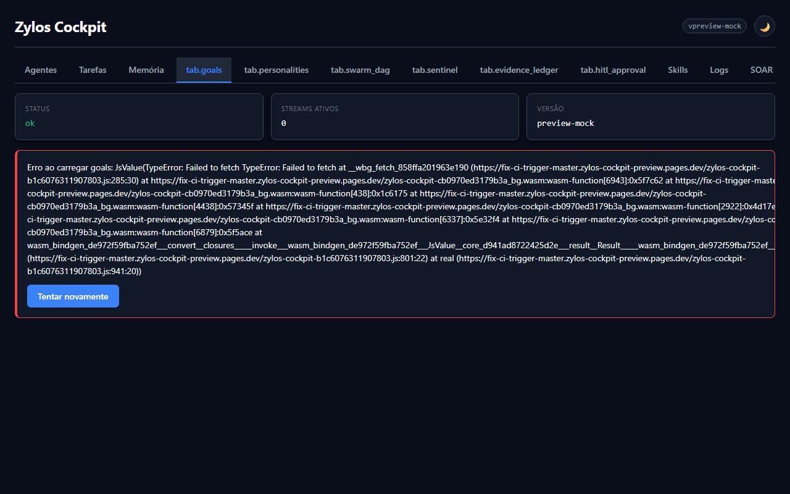

*Estado capturado:* "Erro ao carregar goals" — erro de fetch (gateway ausente); rótulo da tab aparece como `tab.goals` (chave i18n sem tradução).

---

### 4.5 Personalities (Presets)
**Ícone:** 🎭  
**Descrição:** Catálogo de personalidades com filtros por division/communication style.

**Componentes:**
- `PersonalitiesPanel`: Grid de cards com preview de traits
- Filtros: division (eng/ops/sec/mgmt), verbosity, tone

**Ações:**
- Aplicar personalidade a agente (dropdown no AgentCard)
- Criar custom personality (form modal)

**Screenshot real (preview, 2026-11-17):**

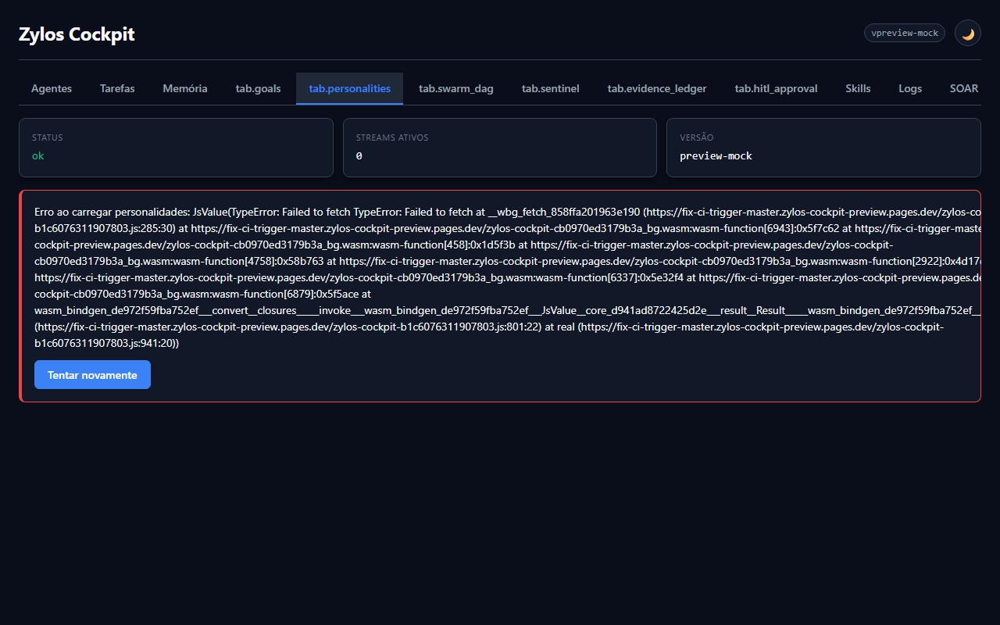

*Estado capturado:* "Erro ao carregar personalidades" — erro de fetch (gateway ausente); rótulo `tab.personalities` sem tradução.

---

### 4.6 SwarmDag (Orquestração)
**Ícone:** 🕸️  
**Descrição:** DAG de swarm orchestration com hop count circuit breaker.

**Componentes:**
- `SwarmDagPanel`: Visualização de crews ativas
- Métricas: success rate, avg duration, hop count distribution

**Ações:**
- Spawn nova crew (form com goal/agents/models)
- Monitorar execução em tempo real
- Abort crew (emergency stop)

**Screenshot real (preview, 2026-11-17):**

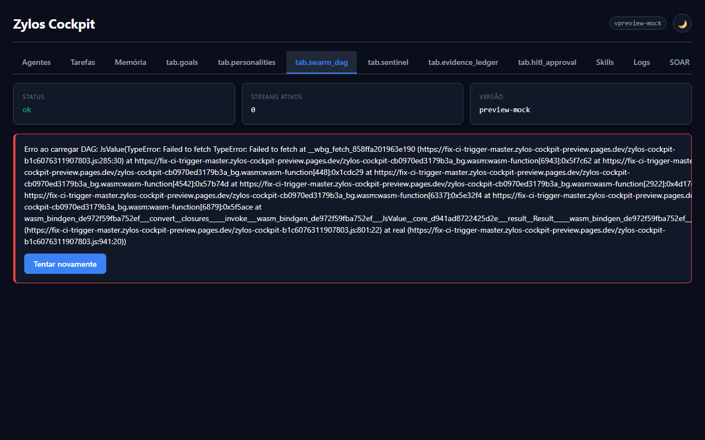

*Estado capturado:* "Erro ao carregar DAG" — erro de fetch (gateway ausente); rótulo `tab.swarm_dag` sem tradução.

---

### 4.7 Sentinel (AIOps)
**Ícone:** 👁️  
**Descrição:** Monitoramento de anomalias e alertas automáticos.

**Componentes:**
- `SentinelPanel`: Lista de anomalias detectadas (CPU, memory, latency)
- Gráficos de baseline vs actual

**Ações:**
- Acknowledge alerta
- Escalar para SOAR workflow
- Ajustar thresholds

**Screenshot real (preview, 2026-11-17):**


*Estado capturado:* "Erro ao carregar sentinel" — erro de fetch (gateway ausente); rótulo `tab.sentinel` sem tradução.

---

### 4.8 EvidenceLedger (Provas)
**Ícone:** 📜  
**Descrição:** Ledger imutável de provas de execução (SHA-256 hashed).

**Componentes:**
- `EvidenceLedgerPanel`: Tabela paginada com filtros
- Export CSV (admin only)

**Ações:**
- Buscar por agent/task/timestamp
- Verificar integridade (re-hash)
- Download bundle (ZIP)

**Screenshot real (preview, 2026-11-17):**

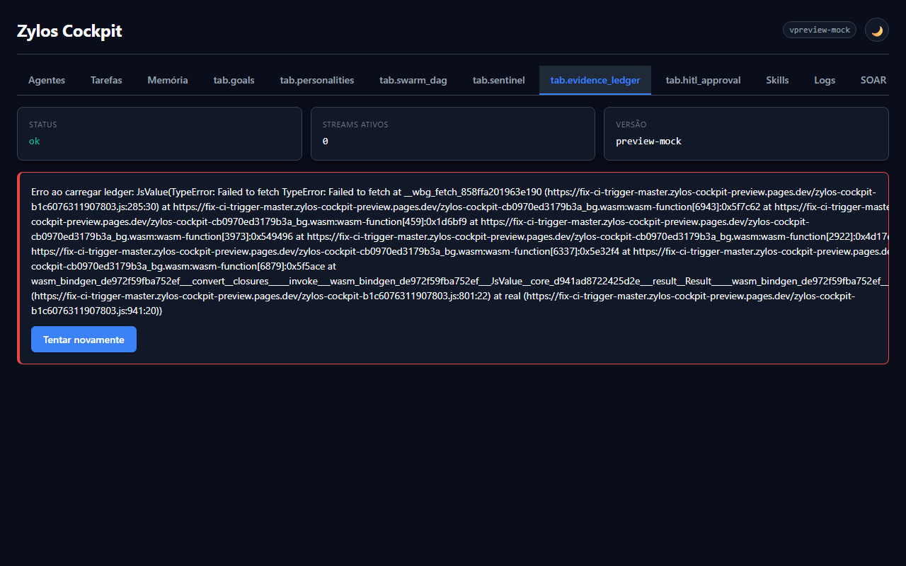

*Estado capturado:* "Erro ao carregar ledger" — erro de fetch (gateway ausente); rótulo `tab.evidence_ledger` sem tradução.

---

### 4.9 HitlApproval (Gates)
**Ícone:** ⚖️  
**Descrição:** Approval gates pendentes com contexto conversacional.

**Componentes:**
- `HitlApprovalPanel`: Cards inline no chat (não modal)
- Preview de risco + alternativas

**Ações:**
- Approve (com reason opcional)
- Reject (reason obrigatório)
- Delegate para outro agent

**Screenshot real (preview, 2026-11-17):**

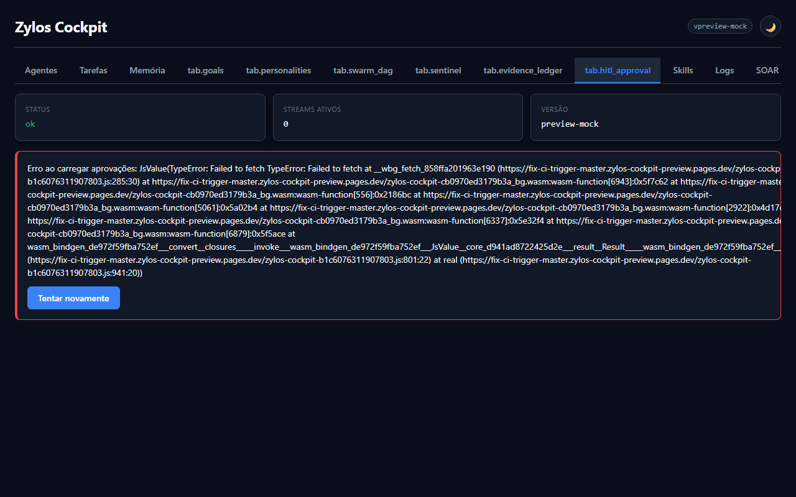

*Estado capturado:* "Erro ao carregar aprovações" — erro de fetch (gateway ausente); rótulo `tab.hitl_approval` sem tradução.

---

### 4.10 Skills (Registry)
**Ícone:** 🛠️  
**Descrição:** Catálogo de skills com hierarquia 3-tier (Planning/Functional/Atomic).

**Componentes:**
- `BenchmarkPanel`: Lista com filtros por tier/category
- Métricas: usage count, success rate, avg latency

**Ações:**
- Ver detalhes (SKILL.md completo)
- Editar (admin only)
- Evoluir skill (gera novo contract)

**Screenshot real (preview, 2026-11-17):**

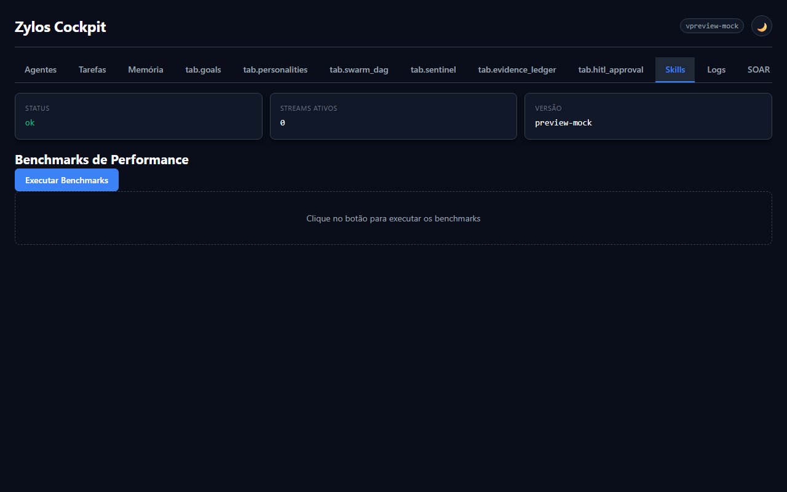

*Estado capturado:* painel "Benchmarks de Performance" com botão "Executar Benchmarks" (o conteúdo real desta tab é `BenchmarkPanel`, não um registry de skills).

---

### 4.11 Logs (Event Feed)
**Ícone:** 📝  
**Descrição:** Stream de eventos em tempo real (WebSocket).

**Componentes:**
- `LiveEventFeed`: Scroll automático, filtros por severity
- Pausar/resume

**Filtros:**
- Severity: info/warn/error
- Agent: todos ou específico
- Keyword search

**Screenshot real (preview, 2026-11-17):**

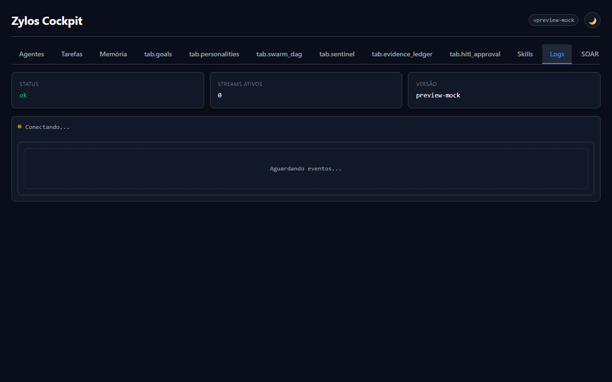

*Estado capturado:* "Conectando... Aguardando eventos..." (SSE sem servidor).

---

### 4.12 Soar (Orchestrator)
**Ícone:** 🎼  
**Descrição:** SOAR (Sense-Orient-Act-Review) workflows com playbook execution.

**Componentes:**
- `SoarDashboard`: Lista de playbooks ativos
- Métricas: completion rate, avg steps, error rate

**Ações:**
- Trigger playbook manualmente
- Pausar execução
- Ver logs detalhados

**Screenshot real (preview, 2026-11-17):**

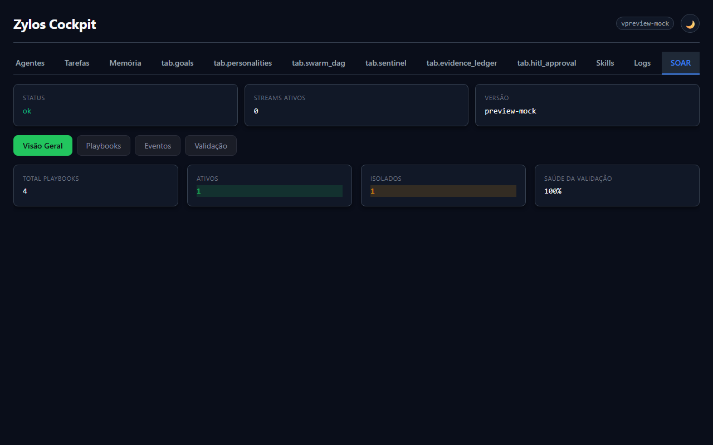

*Estado capturado:* "Visão Geral / Playbooks / Eventos / Validação" com 4 playbooks, 1 ativo, 1 isolado — dados de demonstração embutidos no componente.

---

### 4.13 Security (Scanner)
**Ícone:** 🔒  
**Descrição:** Security audit results com severity breakdown.

**Componentes:**
- `SecurityPanel`: Cards por scan (Snyk, cargo-audit, custom)
- Gráficos de tendência (vulnerabilidades por mês)

**Ações:**
- Trigger novo scan
- Marcar como false positive
- Ver detalhes CVE

**Screenshot real (preview, 2026-11-17):**

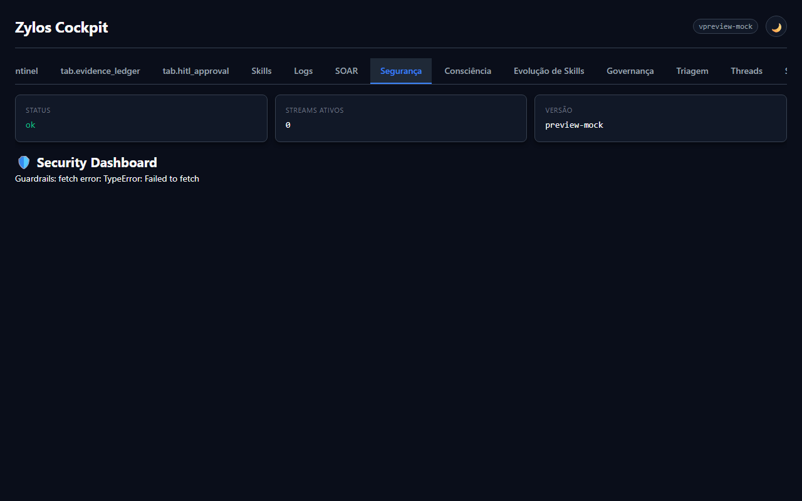

*Estado capturado:* "🛡️ Security Dashboard — Guardrails: fetch error" — erro de fetch (gateway ausente).

---

### 4.14 Awareness (Estados)
**Ícone:** 💭  
**Descrição:** Agent awareness states (Idle/Thinking/Executing/WaitingApproval/Error/Completed).

**Componentes:**
- `AgentAwarenessPanel`: Timeline de transições de estado
- Filtros por agente/período

**Screenshot real (preview, 2026-11-17):**

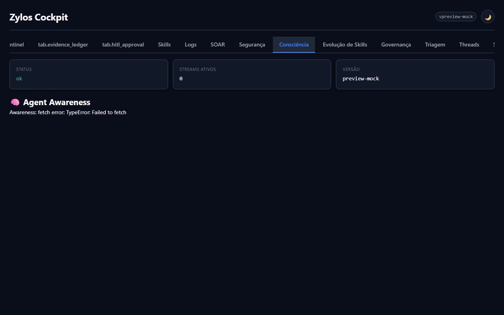

*Estado capturado:* "🧠 Agent Awareness — fetch error" — erro de fetch (gateway ausente).

---

### 4.15 SkillEvolution (Graph)
**Ícone:** 🧬  
**Descrição:** Grafo de evolução de skills com edges (Extends/Replaces/Repairs/DependsOn).

**Componentes:**
- `SkillEvolutionPanel`: Visualização petgraph
- Filtros por tipo de edge

**Ações:**
- Clique em nó → ver contract completo
- Hover → mostra métricas de uso

**Screenshot real (preview, 2026-11-17):**

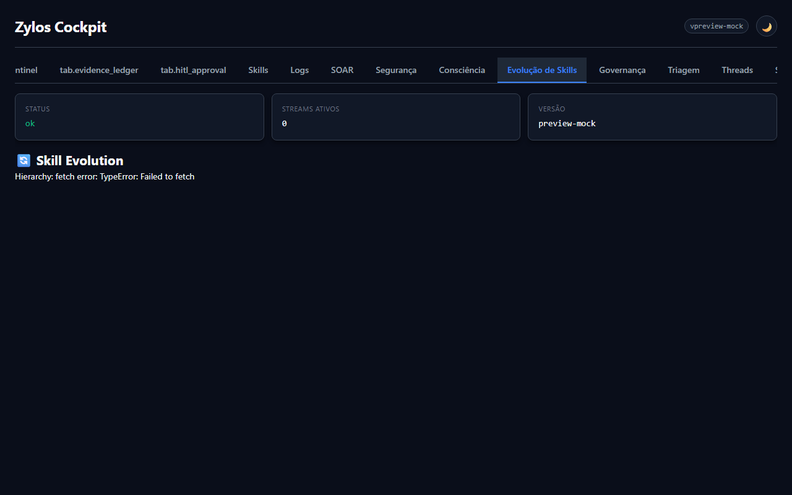

*Estado capturado:* "🔄 Skill Evolution — Hierarchy: fetch error" — erro de fetch (gateway ausente).

---

### 4.16 EmployeeGovernance (Roles)
**Ícone:** 👔  
**Descrição:** Governança de AI employees com roles, rotinas, rate limits.

**Componentes:**
- `EmployeeGovernancePanel`: Tabela de employees com roles
- Métricas: routine execution, rate limit hits

**Ações:**
- Atribuir role (dropdown)
- Editar rotina (YAML editor)
- Ajustar rate limit (token bucket)

**Screenshot real (preview, 2026-11-17):**

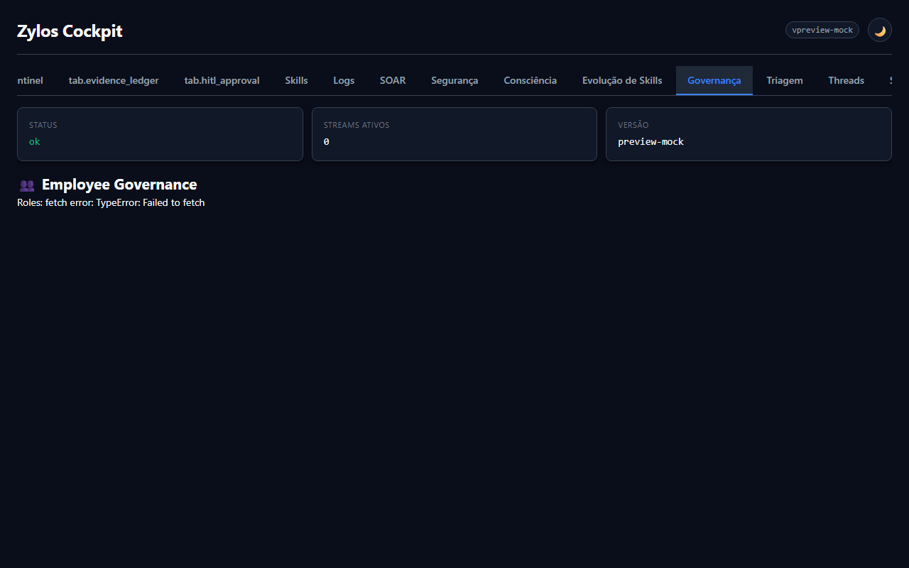

*Estado capturado:* "👥 Employee Governance — Roles: fetch error" — erro de fetch (gateway ausente).

---

### 4.17 TaskTriage (InboxSurface)
**Ícone:** 📥  
**Descrição:** Inbox de tarefas com priorização automática (needs_you/can_wait/errors/done).

**Componentes:**
- `TaskTriagePanel`: 4 colunas Kanban-style
- Auto-refresh 30s

**Ações:**
- Drag-and-drop entre colunas
- Marcar como done
- Escalar para HITL approval

**Screenshot real (preview, 2026-11-17):**

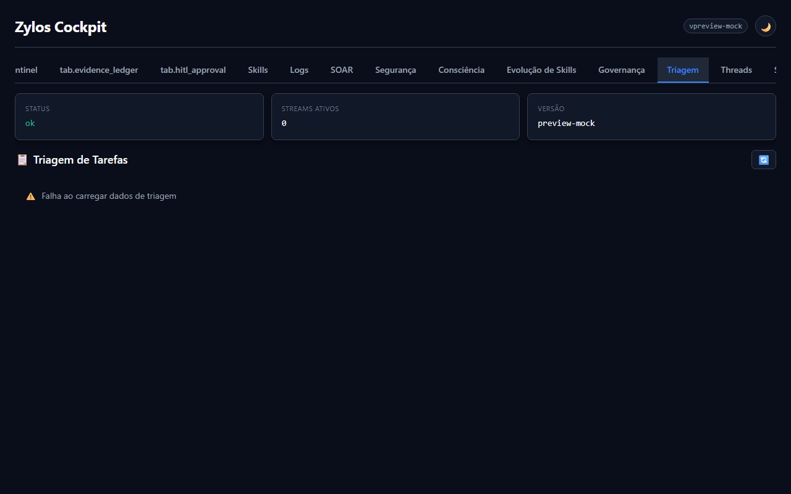

*Estado capturado:* "⚠️ Falha ao carregar dados de triagem" — erro de fetch (gateway ausente).

---

### 4.18 Threads (Conversas)
**Ícone:** 🧵  
**Descrição:** Gerenciamento de threads conversacionais com reordenação.

**Componentes:**
- `ThreadManager`: Lista com botões ↑/↓, delete
- Preview de última mensagem

**Ações:**
- Criar nova thread
- Reordenar (drag ou botões)
- Arquivar thread

**Screenshot real (preview, 2026-11-17):**

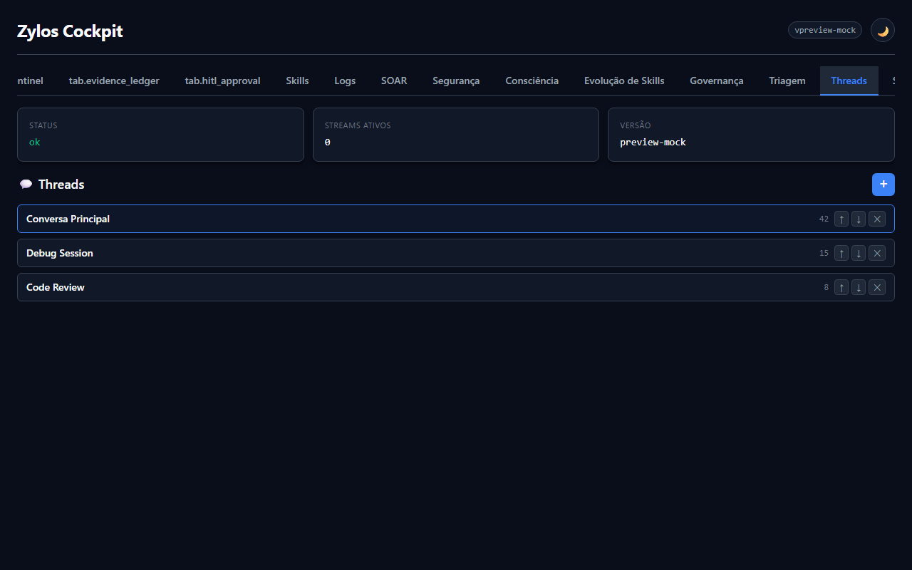

*Estado capturado:* 3 threads de exemplo (Conversa Principal, Debug Session, Code Review) com botões ↑ ↓ ✕ — dados de demonstração embutidos no componente.

---

### 4.19 Subagents (Status)
**Ícone:** 🔀  
**Descrição:** Cards de status de subagentes spawned (running/completed/failed).

**Componentes:**
- `SubagentStatusCards`: Grid com progresso, tokens usados, duração
- Auto-refresh 5s

**Ações:**
- Ver logs do subagent
- Abort subagent (emergency stop)

**Screenshot real (preview, 2026-11-17):**

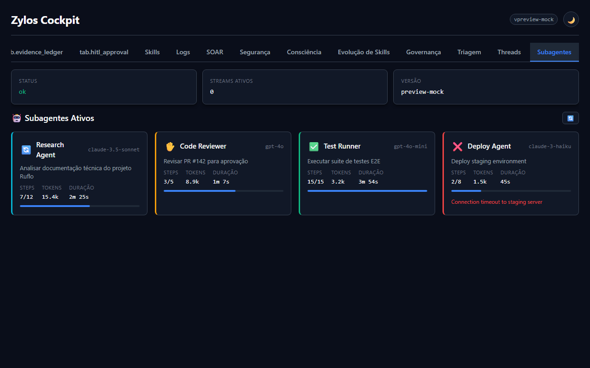

*Estado capturado:* cards de subagentes (Research Agent, Code Reviewer…) com steps/tokens/duração — dados de demonstração embutidos no componente.

---

### 4.20 Files (Manager)
**Ícone:** 📁  
**Descrição:** Gerenciador de arquivos com upload/download/preview.

**Componentes:**
- `FileManager`: Tabela com sorting, busca
- Preview de imagens/texto inline

**Ações:**
- Upload (drag-and-drop ou botão)
- Download
- Delete (admin only)

**Screenshot real (preview, 2026-11-17):**

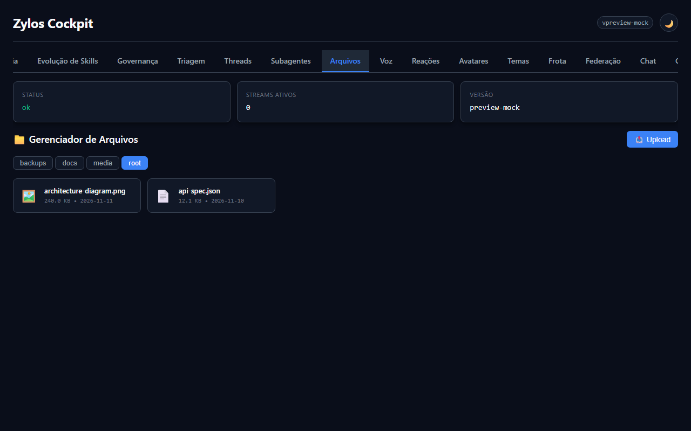

*Estado capturado:* árvore backups/docs/media e arquivos de exemplo — dados de demonstração embutidos no componente.

---

### 4.21 Voice (Panel)
**Ícone:** 🎤  
**Descrição:** Painel de voice interaction (STT/TTS).

**Componentes:**
- `VoicePanel`: Controles de mic/speaker, transcript em tempo real
- Indicadores de qualidade (latency, confidence)

**Screenshot real (preview, 2026-11-17):**

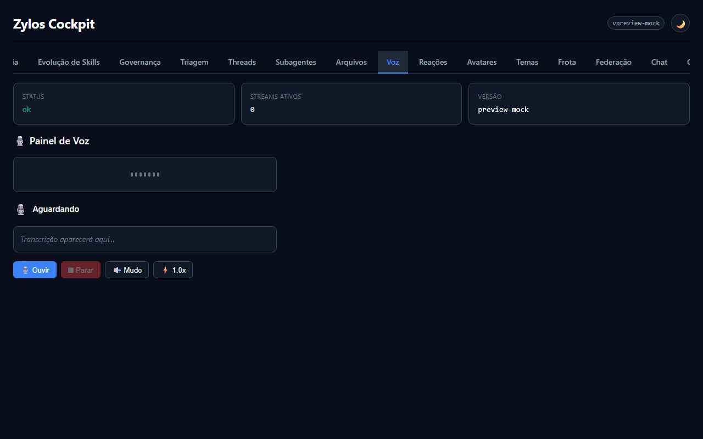

*Estado capturado:* "Aguardando — Transcrição aparecerá aqui" com botões Ouvir/Parar/Mudo/1.0x.

---

### 4.22 Reactions (Emoji)
**Ícone:** 😀  
**Descrição:** Reações emoji em mensagens com contadores.

**Componentes:**
- `EmojiReactions`: Chips clicáveis com contadores
- Picker de emoji custom

**Screenshot real (preview, 2026-11-17):**

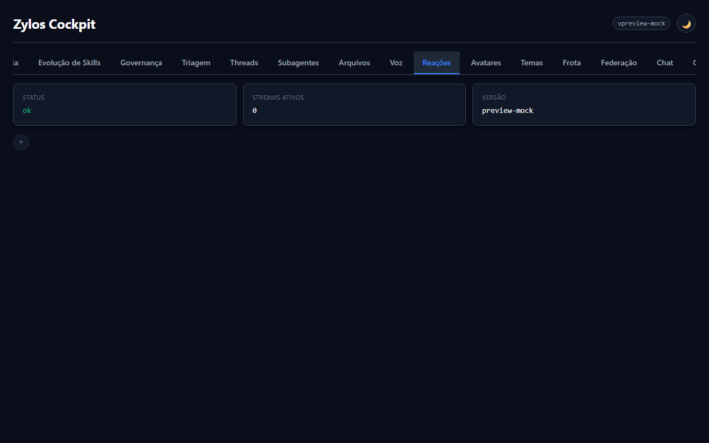

*Estado capturado:* apenas o chip "+" (sem mensagens para reagir).

---

### 4.23 Avatars (Grid)
**Ícone:** 🖼️  
**Descrição:** Grid de avatares por division com status indicators.

**Componentes:**
- `AgentAvatarsGrid`: Círculos coloridos por division
- Badge de status (online/busy/away/offline)

**Screenshot real (preview, 2026-11-17):**

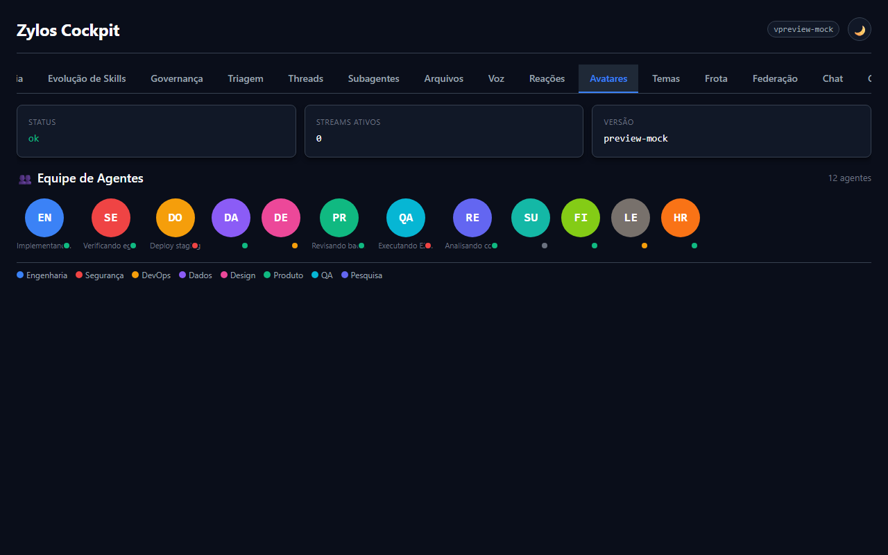

*Estado capturado:* "Equipe de Agentes — 12 agentes" com iniciais e tarefa atual — dados de demonstração embutidos no componente.

---

### 4.24 Skins (Themes)
**Ícone:** 🎨  
**Descrição:** 7 temas visuais (Dark/Light/Monokai/Solarized/Nord/Dracula/Cyberpunk).

**Componentes:**
- `SkinThemesPanel`: Cards com preview de cores
- Aplicação imediata com persistência

**Screenshot real (preview, 2026-11-17):**

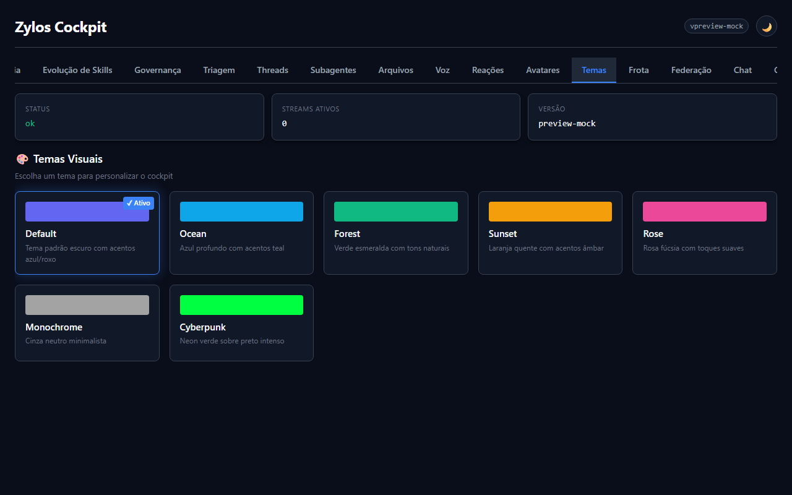

*Estado capturado:* cards de temas (Default ativo, Ocean, Forest…) — dados de demonstração embutidos no componente. Obs.: os nomes reais diferem da lista "Monokai/Solarized/…" desta seção.

---

### 4.25 Fleet (Auditor)
**Ícone:** 🚢  
**Descrição:** Auditoria de fleet com métricas de custo/eficácia por bot.

**Componentes:**
- `FleetAuditorPanel`: Tabela com sorting, filtros por período
- Gráficos de tendência (custo vs eficácia)

**Screenshot real (preview, 2026-11-17):**

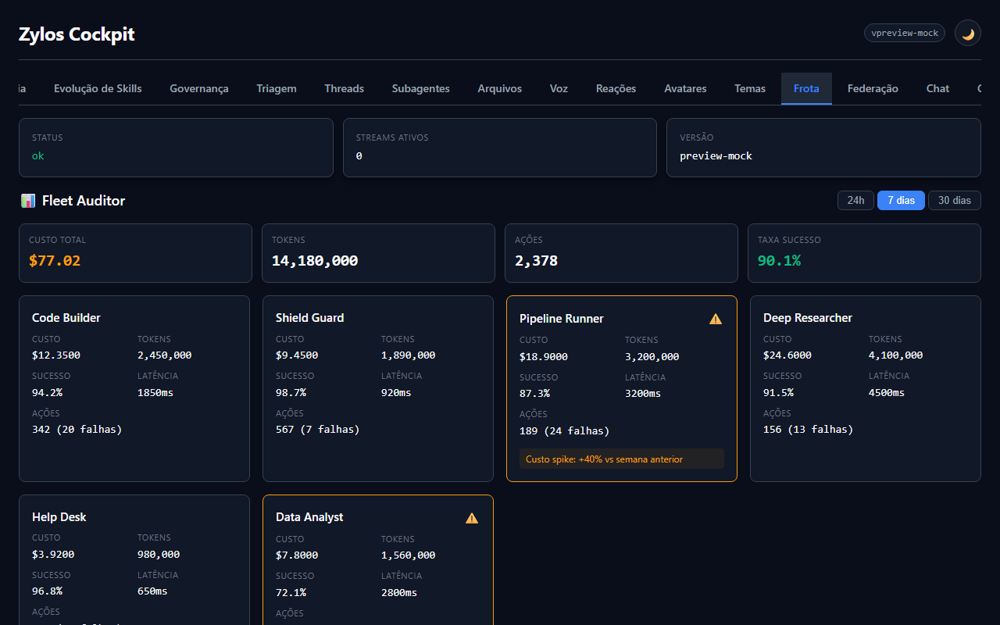

*Estado capturado:* Fleet Auditor com custo total $77.02, 14.180.000 tokens, 90.1% sucesso — dados de demonstração embutidos no componente.

---

### 4.26 Federation (Dashboard)
**Ícone:** 🌐  
**Descrição:** Dashboard de federação com HLC/VectorClock/Conflict Resolution.

**Componentes:**
- `FederationDashboard`: Métricas de sync, conflitos resolvidos
- Lista de nós federados com latência

**Screenshot real (preview, 2026-11-17):**

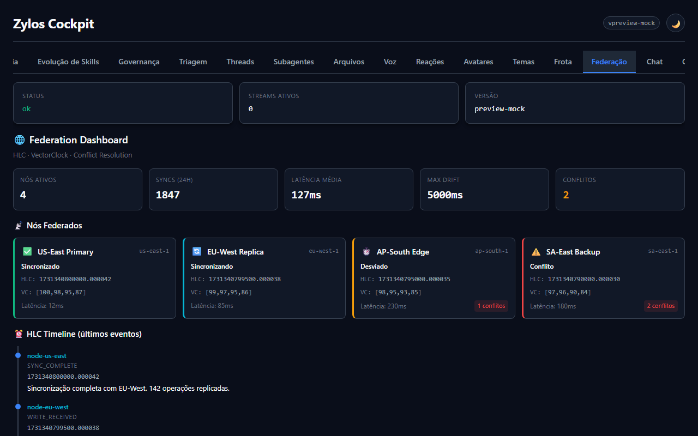

*Estado capturado:* 4 nós, 1847 syncs/24h, 127ms latência média — dados de demonstração embutidos no componente.

---

### 4.27 Chat (Panel)
**Ícone:** 💬  
**Descrição:** Chat interface com autocomplete de skills, menções @agent.

**Componentes:**
- `ChatPanel`: Histórico com scroll, input com autocomplete
- Inline approval cards (não modal)

**Ações:**
- Enviar mensagem (Enter)
- Mencionar agente (@nome)
- Anexar arquivo (drag-and-drop)

**Screenshot real (preview, 2026-11-17):**

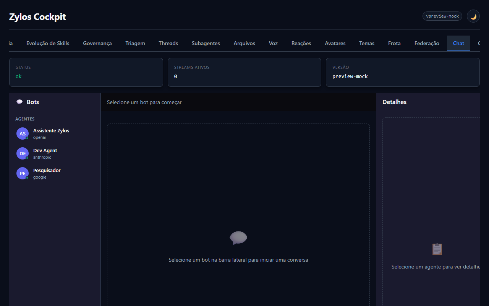

*Estado capturado:* lista de bots (Assistente Zylos/openai, Dev Agent/anthropic, Pesquisador/google) e "Selecione um bot".

---

### 4.28 Channels (Sistema)
**Ícone:** 📡  
**Descrição:** Sistema de canais com persistência SQLite, join/leave, mensagens.

**Componentes:**
- `ChannelPanel`: Lista de canais com unread badges
- Mensagens paginadas, input com Enter/envio

**Ações:**
- Join channel (botão "Entrar")
- Leave channel (botão "Sair")
- Enviar mensagem (Enter ou botão)

**Backend:** `zylos-channels` com SQLite persistente

**Screenshot real (preview, 2026-11-17):**

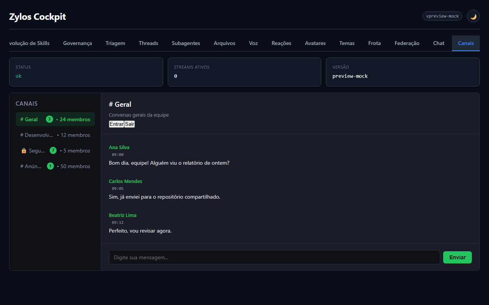

*Estado capturado:* canais #Geral, #Desenvolvimento, 🔒Segurança, #Anúncios com mensagens — dados de demonstração embutidos no componente.

---

### 4.29 PhoneRelay (Mobile)
**Ícone:** 📱  
**Descrição:** Relay de tela mobile com QR pairing, WebSocket streaming, controle remoto.

**Componentes:**
- `PhoneRelayPanel`: QR code placeholder, lista de dispositivos pareados
- Canvas rendering de frames base64
- Indicadores FPS/latência/bitrate

**Ações:**
- Parear novo dispositivo (scan QR)
- Iniciar relay (botão)
- Controle remoto (click/touch/key events)

**Backend:** `webrtc_relay.rs` no gateway

**Screenshot real (preview, 2026-11-17):**

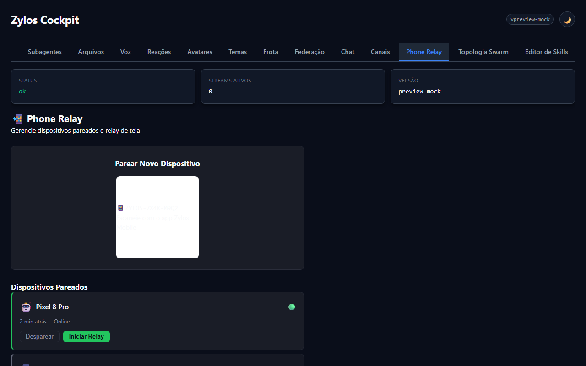

*Estado capturado:* código de pareamento `ZYLOS-7X4K-M9Q2` e dispositivo "Pixel 8 Pro" — dados de demonstração embutidos no componente.

---

### 4.30 SkillEditor (Visual)
**Ícone:** ✏️  
**Descrição:** Editor visual de skills com syntax highlighting YAML, validação, undo/redo.

**Componentes:**
- `SkillEditorPanel`: Lista de skills, editor de steps, preview YAML
- Syntax highlighting (keywords/strings/numbers/comments)
- Validação em tempo real (erros inline)

**Ações:**
- Add Step (botão toolbar)
- Undo/Redo (stack de 20 estados)
- Save to Backend (POST `/api/v1/hermes/skill-evolution/contracts`)

**Backend:** Integração com Hermes skill-evolution API

**Screenshot real (preview, 2026-11-17):**

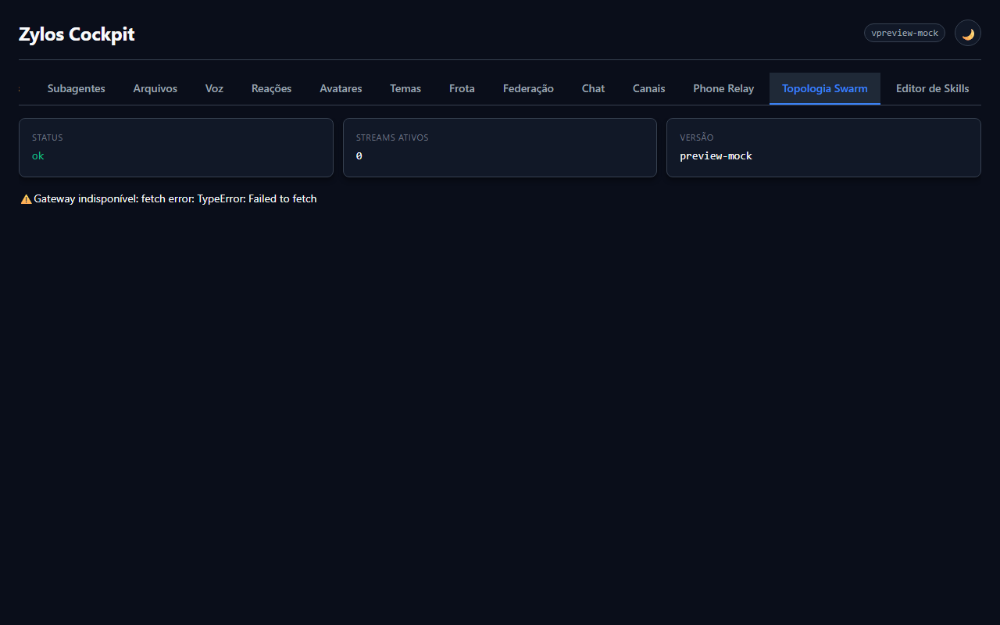

*Estado capturado:* "⚠️ Gateway indisponível: fetch error" — erro de fetch (gateway ausente).

---

### 4.31 SwarmTopology (Interativo)
**Ícone:** 🕸️  
**Descrição:** Topologia SVG interativa com drag-and-drop, zoom/pan, localStorage.

**Componentes:**
- `SwarmTopologyPanel`: Nós coloridos por tipo (agent/orchestrator/gateway/tool)
- Arestas com dash arrays (control/data/heartbeat)
- Tooltip on hover, animação de arestas ativas

**Ações:**
- Drag-and-drop de nós (persiste em localStorage)
- Zoom via wheel (0.25x – 4x)
- Pan via drag no background
- Resetar layout (botão)

**Backend:** Polling `/api/v1/hermes/bot/spawn-crew` a cada 5s

**Screenshot real (preview, 2026-11-17):**

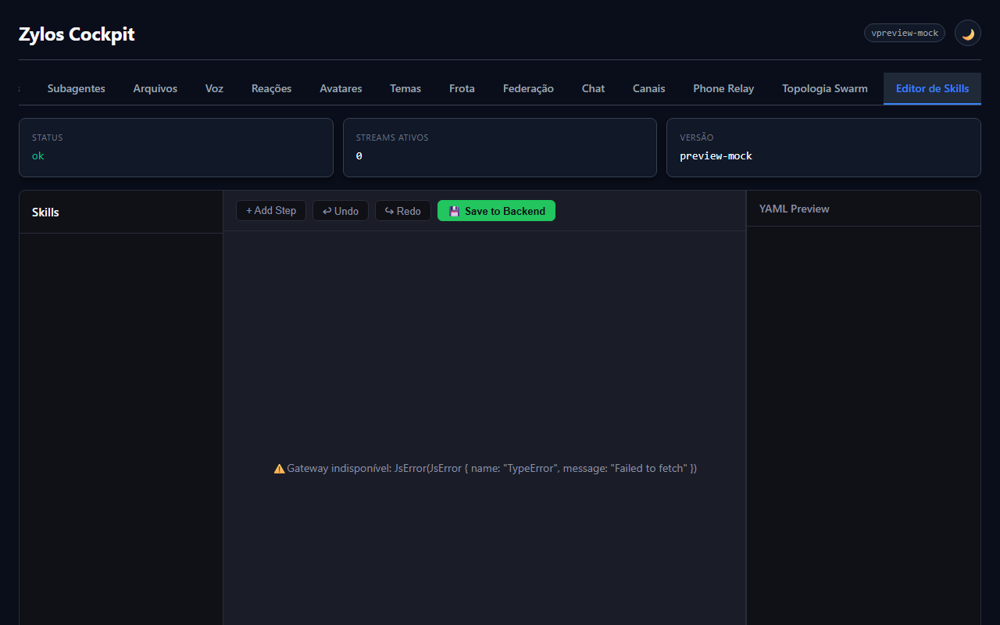

*Estado capturado:* toolbar (+ Add Step, Undo, Redo, Save to Backend) e "⚠️ Gateway indisponível" — erro de fetch (gateway ausente).

---

## 5. Workflows Comuns

### 5.1 Aprovar Tarefa Crítica
1. Abra tab **HitlApproval**
2. Localize card com contexto da tarefa
3. Leia preview de risco + alternativas
4. Clique "Approve" (reason opcional) ou "Reject" (reason obrigatório)
5. Confirmação via toast notification

### 5.2 Monitorar Anomalia
1. Abra tab **Sentinel**
2. Identifique anomalia (CPU/memory/latency)
3. Clique "Acknowledge" para marcar como visto
4. Se crítico, clique "Escalate to SOAR" → abre playbook

### 5.3 Editar Skill
1. Abra tab **SkillEditor**
2. Selecione skill na lista à esquerda
3. Edite steps no painel central
4. Preview YAML atualiza em tempo real
5. Validação mostra erros inline (se houver)
6. Clique "Save to Backend" → confirmação via toast

### 5.4 Parear Dispositivo Mobile
1. Abra tab **PhoneRelay**
2. Escaneie QR code com app mobile Zylos
3. Dispositivo aparece na lista "Pareados"
4. Clique "Iniciar Relay" → canvas exibe tela remota
5. Use mouse/keyboard para controle remoto

---

## 6. Keyboard Shortcuts

> **Atenção:** em 2026-11-17 não há handler global de teclado no cockpit (apenas `channel_panel.rs` e `chat_panel.rs` tratam `keydown`, para Enter no input). Os atalhos `1-9`, `Ctrl+K` e `Ctrl+/` abaixo são **planejados, não implementados**. `Tab`/`Shift+Tab`/`Enter` funcionam por serem comportamento nativo do browser.

| Tecla | Ação |
|-------|------|
| `1-9` | Navegar para tab N (1=Agents, 2=Tasks, etc.) |
| `Ctrl+K` | Command palette (busca rápida) |
| `Ctrl+/` | Toggle sidebar |
| `Escape` | Fechar modal/focus trap |
| `Enter` | Confirmar ação (em modais) |
| `Tab` | Navegar entre elementos focusáveis |
| `Shift+Tab` | Navegar para trás |

---

## 7. Troubleshooting

### 7.1 Cockpit não carrega
**Sintoma:** Tela branca ou "Loading..." infinito

**Solução:**
1. Verifique conexão com gateway: `curl http://localhost:3000/api/v1/health`
2. Limpe `localStorage` e `sessionStorage`
3. Hard refresh (Ctrl+Shift+R)
4. Verifique console do browser para erros WASM

### 7.2 Toast de erro "Gateway indisponível"
**Sintoma:** Componentes mostram "Gateway indisponível: ..."

**Solução:**
1. Verifique se gateway está rodando: `cargo run -p zylos-gateway`
2. Verifique CORS (deve permitir `http://localhost:*`)
3. Verifique logs do gateway para erros de conexão

### 7.3 Aprovação não aparece
**Sintoma:** HITL approval gate não aparece no chat

**Solução:**
1. Verifique se `approval_store` está inicializado (logs do gateway)
2. Verifique se agent tem `requires_approval: true` no config
3. Verifique se tab **HitlApproval** está acessível

### 7.4 WebSocket não conecta
**Sintoma:** PhoneRelay não mostra frames, SwarmTopology não atualiza

**Solução:**
1. Verifique se gateway suporta WebSocket upgrade
2. Verifique firewall/proxy (deve permitir `ws://`)
3. Verifique logs do browser para erros de conexão

---

## 8. Referências

### Documentação Técnica
- [DESIGN_SYSTEM.md](./DESIGN_SYSTEM.md) — Design tokens, component specs
- [AGENTS.md](../AGENTS.md) — Regras de auto-invocação, 10 camadas
- [IMPLEMENTATION_PLAN_FASE10.md](./IMPLEMENTATION_PLAN_FASE10.md) — Plano completo
- [HANDOFF_FASE10.md](./handoffs/HANDOFF_FASE10.md) — Resumo executivo

### Documentação Operacional
- [pb-auth-setup.md](../playbooks/pb-auth-setup.md) — Setup de autenticação
- [pb-crdt-onboarding.md](../playbooks/pb-crdt-onboarding.md) — Onboarding CRDT
- [pop-token-revoke.md](../runbooks/pop-token-revoke.md) — Revogação de tokens
- [pop-crdt-conflict-resolve.md](../runbooks/pop-crdt-conflict-resolve.md) — Resolução de conflitos

### Repositórios
- **Cockpit:** `apps/zylos-cockpit/`
- **Gateway:** `apps/zylos-gateway/`
- **Crates:** `crates/` (zylos-channels, zylos-auth, zylos-analytics, etc.)

---

## 9. Sobre os Screenshots

- **Origem:** preview Cloudflare Pages `https://fix-ci-trigger-master.zylos-cockpit-preview.pages.dev` (deploy do workflow `.github/workflows/deploy-preview.yml`), capturado em 2026-11-17 com Chrome headless 1280×800 via `playwright-core`.
- **Script reprodutível:** `docs/assets/screenshots/capture-cockpit-screenshots.js` (`npm i playwright-core@1 && node capture-cockpit-screenshots.js <dir-saida>`; ajuste `CHROME` para o caminho do seu Chrome).
- **`00-offline-gateway.png`**: estado 100% real, sem nenhuma interceptação.
- **`01..31-*.png`**: para que as tabs renderizem, o script intercepta **apenas** `GET http://localhost:3000/api/v1/health` e responde `{"status":"ok","active_streams":0,"version":"preview-mock"}` (por isso o header mostra `vpreview-mock`). Todas as outras chamadas a `localhost:3000` são recusadas — por isso muitos painéis mostram erro de fetch. Os painéis que aparecem populados usam dados de demonstração embutidos no próprio componente, não dados de produção.
- **Problemas visíveis nos screenshots (registrados para correção):** 6 tabs exibem a chave i18n crua (`tab.goals`, `tab.personalities`, `tab.swarm_dag`, `tab.sentinel`, `tab.evidence_ledger`, `tab.hitl_approval`) porque faltam entradas em `apps/zylos-cockpit/src/i18n.rs`; erros de fetch exibem o stack trace WASM inteiro ao usuário.
- **Atualizar:** quando o gateway de produção estiver no ar, re-execute o script sem a interceptação de health e substitua os PNGs.

---

**Última atualização:** 2026-11-17  
**Mantido por:** Hermes Agent (via skill `documentation-author`)