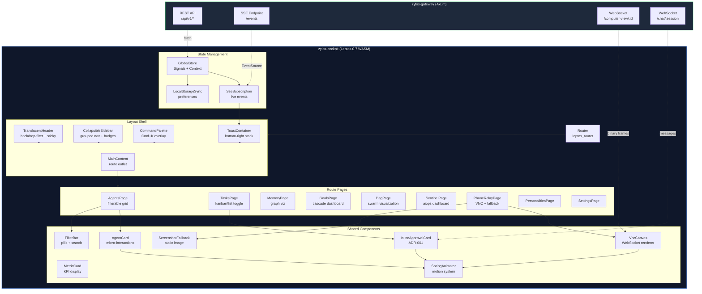
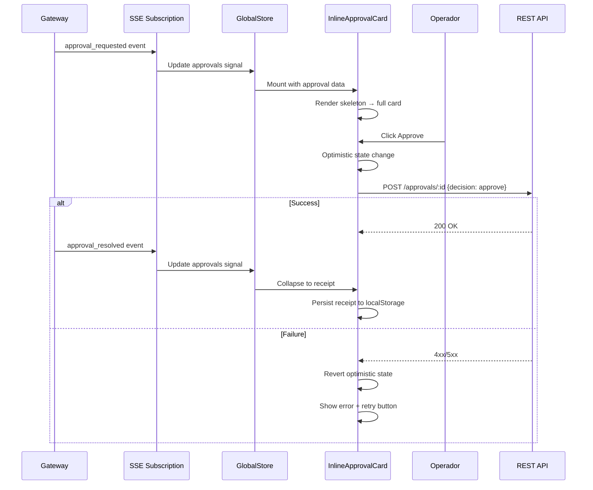

# Architecture — Zylos Cockpit v2.0 Redesign

**Versão:** 2.0.0
**Data:** 2026-11-18
**Status:** Planejamento
**Conceito Manifesto:** #2 (Arquitetura definida antes da implementação)
**Depende de:** [PRD.md](./PRD.md)

---

## 1. Visão Geral Arquitetural

O Cockpit v2.0 mantém a arquitetura CSR (Client-Side Rendering) com Leptos 0.7 compilado para WASM, comunicando-se com o gateway Axum via protocolo AG-UI (SSE + REST + WebSocket). As mudanças são exclusivamente no layer de apresentação: novo sistema de design, componentes reescritos, animation system, e integração VNC.

### Princípios Arquiteturais
1. **Single Source of Truth para Design** — `design-tokens.css` é o único arquivo de tokens; componentes consomem via CSS variables
2. **State Co-location** — Estado de UI vive no componente mais próximo possível; estado global apenas para auth, theme preferences, e SSE subscriptions
3. **Progressive Enhancement** — VNC com fallback para screenshot; springs com fallback para CSS transitions; translucency com fallback opaco
4. **Zero Runtime CSS-in-Rust** — Estilos via CSS files + classes; Leptos `style:` attribute apenas para valores dinâmicos calculados
5. **Bundle Budget Enforcement** — CI gate falha build se WASM gzipped >800KB

---

## 2. Diagrama C4 Level 3: Componentes do Cockpit



---

## 3. Tech Stack Detalhado

| Layer | Tecnologia | Versão | Justificativa |
|-------|-----------|--------|---------------|
| Framework | Leptos | 0.7.x | Signal-based reactivity, SSR/CSR, Rust-native |
| Build | Trunk | 0.22.1 | WASM bundler, asset pipeline, dev server |
| Routing | leptos_router | 0.7.x | Nested routes, params, guards |
| Animation | leptos-spring OU custom WASM solver | TBD | ADR-007 decidirá; fallback garantido |
| Networking | gloo-net | compat | Fetch, WebSocket, EventSource wrappers |
| Storage | web-sys + serde | compat | localStorage for preferences, sidebar state |
| Icons | leptos-icons OU inline SVG | TBD | Tree-shakeable, no runtime overhead |
| CSS | Vanilla CSS + CSS Variables | native | Zero runtime, design-tokens.css como SSoT |
| Sanitization | ammonia (WASM) | compat | XSS prevention em approval cards |
| Testing | wasm-bindgen-test + playwright | compat | Unit tests + E2E visual regression |

### Decisão Pendente: ADR-007 (Spring System)
- **Opção A:** `leptos-spring` crate — comunidade, mantida, pode não suportar Leptos 0.7
- **Opção B:** Custom WASM spring solver — controle total, ~2KB overhead, manutenção própria
- **Critério de decisão:** Compatibilidade com Leptos 0.7 signals + bundle size impact
- **Deadline:** Antes da Fase 2 do Implementation Plan

---

## 4. Fluxo de Dados

### 4.1 SSE Event Flow (Live Updates)
```
Gateway → SSE /events → SseSubscription Signal → GlobalStore → Components
```
- Eventos: `agent_status_changed`, `task_created`, `approval_requested`, `sentinel_alert`, `stream_connected`
- Reconnection: exponential backoff (1s, 2s, 4s, max 30s)
- Buffer: últimos 100 eventos em memória para late subscribers

### 4.2 Inline Approval Flow (ADR-001)
```
SSE approval_requested → InlineApprovalCard mount → User action → POST /api/v1/approval/resolve → SSE approval_resolved → Card collapse to receipt
```
- Optimistic update: card muda estado imediatamente, reverte se POST falhar
- Equivalence hash exibido para verificação humana
- Receipt persistido em localStorage para sobreviver a refresh

### 4.3 VNC Stream Flow (ADR-003)
```
PhoneRelayPage mount → WS connect /computer-view/:session → Binary frames → Canvas render → Quality monitor → Adaptive scaling
                                                    ↓ (timeout 3s)
                                              ScreenshotFallback mount → GET [NÃO EXISTE — criar em Fase 5 backend]
```
- Frame format: JPEG base64-encoded ou raw RGB (decidir em spec)
- Quality scaling: monitora frame interval; se >66ms (<15fps), reduz resolução pela metade
- Lease management: Take Control envia POST /ws/computer-view/{session_id}/lease; auto-release após 5min inatividade

### 4.4 Command Palette Flow (ADR-009)
```
Cmd+K → CommandPalette mount → Focus input → Fuzzy search (client-side) → Results render → Enter/Click → Execute action → Palette close
```
- Index construído em mount: telas, agentes, tarefas, comandos, skills
- Search algorithm: Fuse.js-style fuzzy matching em WASM
- Histórico: últimos 10 comandos em localStorage, mostrados primeiro

---

## 5. Integração com Protocolo AG-UI

O Cockpit consome o protocolo AG-UI definido em `zylos-live-comm`. Endpoints relevantes:

| Endpoint | Método | Uso no Cockpit v2 |
|----------|--------|-------------------|
| `/events` | SSE | Live updates globais |
| `/api/v1/agents` | GET | Lista de agentes para AgentsPage |
| `/api/v1/agents/:id` | GET | Detalhes do agente para AgentCard |
| `/api/v1/tasks` | GET | TasksPage data |
| `/api/v1/approval/resolve` | POST | Inline approval decision |
| ⚠️ `/api/v1/approvals/:id/details` | GET | **[CRIAR]** Detalhes da aprovação para InlineApprovalCard |
| `/ws/computer-view/{session_id}` | WS | VNC stream |
| `[NÃO EXISTE — criar em Fase 5 backend]` | GET | Screenshot fallback |
| `/api/v1/memory/graph` | GET | MemoryPage visualization |
| `/api/v1/sentinel/alerts` | GET | SentinelPage data |
| `/api/v1/config/preferences` | PUT | Save user preferences |

**Nota:** Nenhum endpoint novo é necessário. Todas as features do v2.0 usam APIs existentes.

---

## 6. Estrutura de Arquivos Frontend

```
apps/zylos-cockpit/
├── Cargo.toml
├── Trunk.toml
├── index.html
├── styles/
│   ├── design-tokens.css      ← SINGLE SOURCE OF TRUTH (ADR-008)
│   ├── base.css               ← Reset, typography, utilities
│   └── components/            ← Component-specific styles (optional)
│       ├── agent-card.css
│       ├── inline-approval.css
│       ├── command-palette.css
│       └── vnc-canvas.css
├── src/
│   ├── main.rs                ← Entry point, router setup
│   ├── app.rs                 ← Root component, layout shell
│   ├── layout/
│   │   ├── mod.rs
│   │   ├── header.rs          ← TranslucentHeader
│   │   ├── sidebar.rs         ← CollapsibleSidebar
│   │   ├── command_palette.rs ← CommandPalette
│   │   └── toast_container.rs ← ToastContainer
│   ├── pages/
│   │   ├── mod.rs
│   │   ├── agents.rs
│   │   ├── tasks.rs
│   │   ├── memory.rs
│   │   ├── goals.rs
│   │   ├── dag.rs
│   │   ├── sentinel.rs
│   │   ├── phone_relay.rs     ← VNC + fallback
│   │   ├── personalities.rs
│   │   └── settings.rs
│   ├── components/
│   │   ├── mod.rs
│   │   ├── agent_card.rs
│   │   ├── inline_approval_card.rs
│   │   ├── metric_card.rs
│   │   ├── filter_bar.rs
│   │   ├── spring_animator.rs ← ADR-007
│   │   ├── vnc_canvas.rs
│   │   └── screenshot_fallback.rs
│   ├── state/
│   │   ├── mod.rs
│   │   ├── global_store.rs
│   │   ├── sse_subscription.rs
│   │   └── local_storage_sync.rs
│   ├── utils/
│   │   ├── mod.rs
│   │   ├── fuzzy_search.rs
│   │   ├── sanitization.rs
│   │   └── spring_solver.rs   ← Fallback se leptos-spring falhar
│   └── types/
│       ├── mod.rs
│       ├── agent.rs
│       ├── task.rs
│       ├── approval.rs
│       └── event.rs
└── tests/
    ├── wasm_tests.rs           ← wasm-bindgen-test unit tests
    └── e2e/                    ← Playwright visual regression
        ├── agents.spec.ts
        ├── approvals.spec.ts
        └── phone-relay.spec.ts
```

---

## 7. Decisões Arquiteturais Novas

### ADR-007: Spring Animation System
- **Status:** Pendente
- **Contexto:** Como implementar animações fluidas com physics-based springs
- **Opções:** leptos-spring crate vs custom WASM solver
- **Critério:** Compatibilidade Leptos 0.7 + bundle size <5KB overhead
- **Decisão:** TBD na Fase 2

### ADR-008: Unificação de CSS
- **Status:** Aceito
- **Decisão:** `design-tokens.css` como single source of truth; eliminar `style.css`
- **Racional:** Elimina conflito de 3 paletas; CSS variables permitem theming futuro
- **Consequência:** Migração de todos os componentes para consumir tokens via var()

### ADR-009: Command Palette como Primary Navigation
- **Status:** Aceito
- **Decisão:** Cmd+K como método primário de navegação power-user
- **Racional:** Linear/Vercel provaram eficácia; reduz dependência de sidebar para usuários avançados
- **Consequência:** Sidebar torna-se secundária; command palette deve indexar tudo

### ADR-010: Material Translúcido
- **Status:** Aceito
- **Decisão:** backdrop-filter: blur(20px) saturate(180%) em header/sidebar
- **Racional:** Princípio Apple #2 (Materials); cria profundidade visual sem perder contexto
- **Consequência:** Performance monitoring necessário; fallback opaco para low-end devices

---

## 8. Preocupações Transversais

### 8.1 Performance
- **Code splitting:** Route-based lazy loading via `lazy()` do Leptos
- **Tree shaking:** Trunk + wasm-opt com flags agressivos
- **Image optimization:** SVGs inline para icons; WebP para screenshots
- **Memory:** Limitar buffer SSE a 100 eventos; GC-friendly signal patterns

### 8.2 Acessibilidade
- **Keyboard:** Tab order lógico; Cmd+K shortcut; Esc fecha overlays
- **Screen reader:** ARIA labels em todos os interativos; live regions para toasts
- **Reduced motion:** Media query desabilita springs e transições
- **Contrast:** WCAG AA mínimo (4.5:1 text, 3:1 UI); prefers-contrast support

### 8.3 Segurança Frontend
- **XSS:** Ammonia sanitiza todo HTML renderizado em approval cards
- **CSP:** Headers configurados no gateway (script-src self, style-src self unsafe-inline)
- **Token storage:** Auth token em httpOnly cookie (não localStorage)
- **Input validation:** Client-side validation antes de enviar; server-side como autoridade

### 8.4 Error Handling
- **Network errors:** Retry com backoff; toast notification após 3 falhas
- **Component errors:** ErrorBoundary wrapper em cada route; fallback UI com retry
- **VNC errors:** Auto-fallback para screenshot; toast com opção de reconectar
- **Stale state:** SSE reconnect resyncs full state via REST

---

## 9. Compliance com Manifesto

| Conceito | Aplicação |
|----------|-----------|
| #2 Arquitetura antes de implementação | ESTE DOCUMENTO |
| #3 Design System como contrato | Cross-link DESIGN_SYSTEM.md |
| #12 Segurança como camada zero | Seção 8.3 |
| #18 APP_FLOW obrigatório | Cross-link APP_FLOW.md |
| ADR-001 Inline approvals | Seção 4.2 |
| ADR-003 VNC + fallback | Seção 4.3 |
| ADR-007 Spring system | Seção 7 |
| ADR-008 CSS unification | Seção 7 |
| ADR-009 Command palette | Seção 7 |
| ADR-010 Translucent material | Seção 7 |

---

## 10. Diagrama de Sequência: Inline Approval



---

## 11. Próximos Passos

1. Aprovar esta arquitetura
2. Resolver ADR-007 (spring system) na Fase 2
3. Gerar DESIGN_SYSTEM.md com tokens completos
4. Gerar APP_FLOW.md com jornadas e estados
5. Gerar IMPLEMENTATION_PLAN.md com fases gateadas